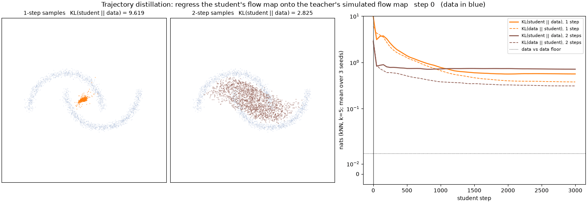
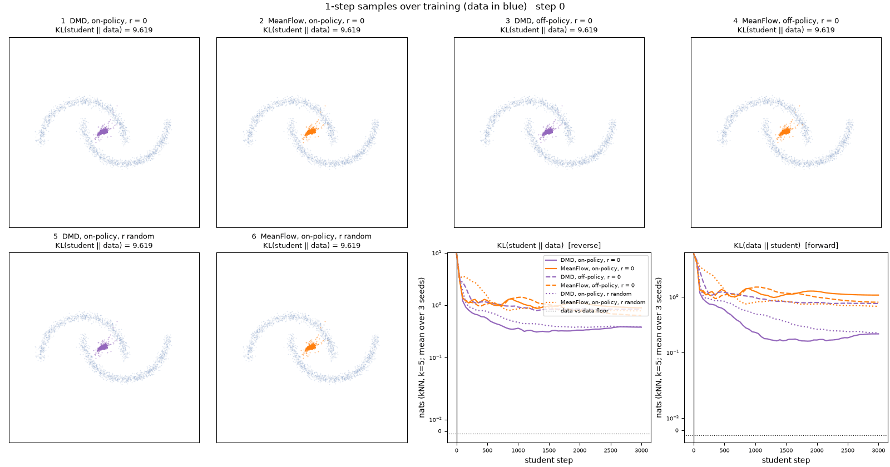
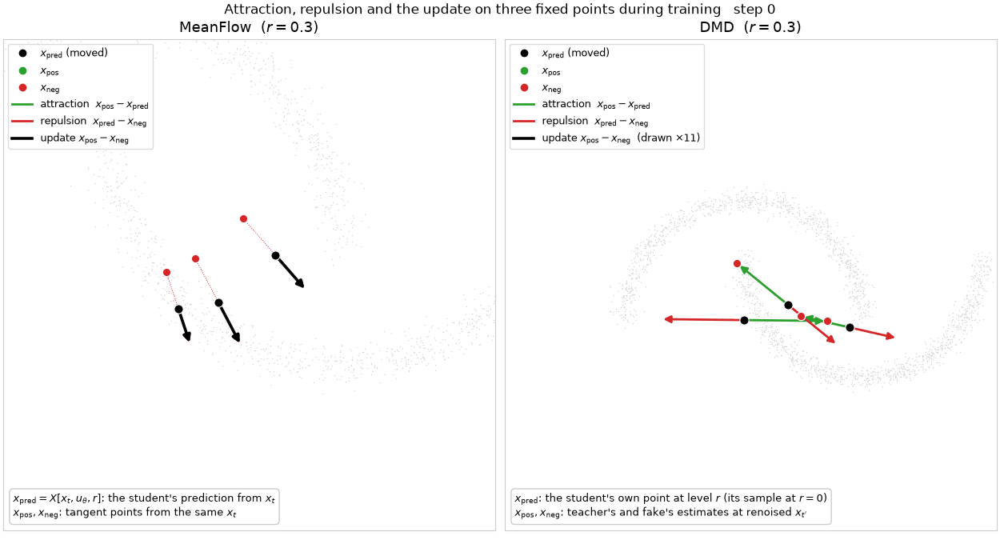
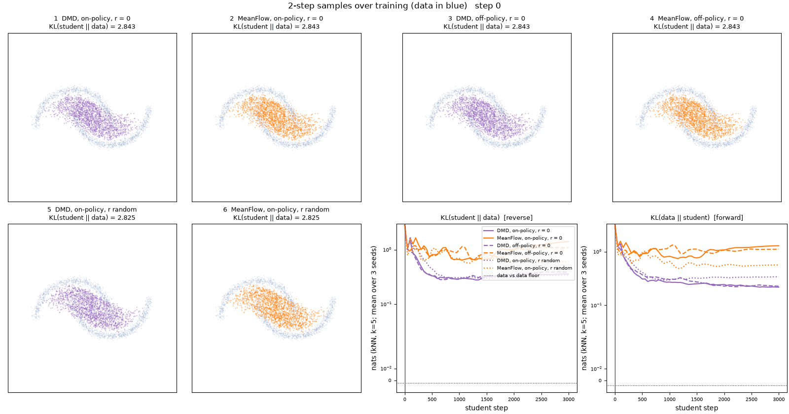
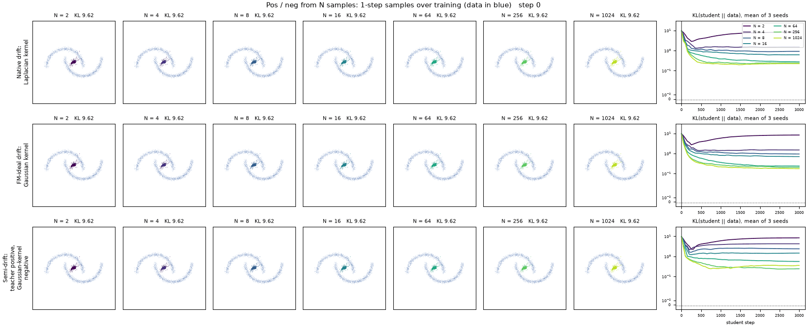

# Contrastive Generation: Training a Few-Step Generator by Pulling and Pushing Its Samples

<!-- F1: title figure, a still from V5 (to render) -->

A few-step generator turns noise into a sample with one or a few network calls. This post shows that two common ways of training such a generator, MeanFlow and Distribution Matching Distillation (DMD), use the same update. Each update moves a point produced by the generator toward a *positive* point, which carries information about the data, and away from a *negative* point, which describes the generator itself. The two methods differ in how they obtain the negative and in which state they build the two points from. The recently proposed drifting models use the same update as well, with both points estimated directly from samples. Section 1 introduces the velocities and the one-step map in which all of these constructions are written.

All pictures and numbers in this post come from one 2D toy problem, the two-moons dataset, with a flow-matching teacher and students distilled from it.

---

## 1. Velocities and flow maps

We use the linear interpolation of flow matching, with data at $t=0$ and noise at $t=1$,

$$
x_t = (1-t)\,x_0 + t\,\epsilon,\qquad x_0\sim p_{\text{data}},\quad \epsilon\sim\mathcal N(0,I).
$$

We call $t$ the noise level, or simply the level, and write $p_{\text{data},t}$ for the distribution of $x_t$, so that $p_{\text{data},0}=p_{\text{data}}$ and $p_{\text{data},1}=\mathcal N(0,I)$.

**Conditional velocity.** One pair $(x_0,\epsilon)$ defines one straight segment, and a point on it moves with velocity $v_{\text{cond}} = \epsilon - x_0$.

**Marginal velocity.** Many segments pass through the same point $x_t$. Their average, weighted by the posterior over pairs given $x_t$, is the marginal velocity

$$
v(x_t,t) = \mathbb E\big[\epsilon - x_0 \,\big|\, x_t\big].
$$

Following a velocity backward to level 0 shows what it encodes. Extending a segment backward by $t$ reaches its own $x_0$, since $x_t - t\,v_{\text{cond}} = x_0$. Extending the marginal velocity backward reaches the posterior mean, $x_t - t\,v(x_t,t) = \mathbb E[x_0\mid x_t]$. For a point between the two moons, this mean lies in the empty region between them.

<!-- V1: ConditionalToMarginal. Segments through one x_t, weighted by the posterior, average into the marginal arrow; t = 0.8, 0.5, 0.2 (to render) -->

**ODE trajectories.** Integrating $dx/dt = v(x,t)$ from $t=1$ to $t=0$ carries noise onto the moons. Unlike the conditional segments, these trajectories never cross, and they are curved. Following them accurately takes many small steps, that is, many network calls, or function evaluations (NFE). Given a state $x_t$, we write $x_s$ for the point at level $s$ on the ODE trajectory through $x_t$. The ODE carries $p_{\text{data},t}$ to $p_{\text{data},s}$, so $x_s$ has the same distribution as the interpolation at level $s$, but it is a deterministic function of $x_t$ rather than a new interpolation sample.

<!-- V2: MarginalODE. Teacher field over t, 400 particles flowing to the moons, two Euler steps missing them (to render) -->

**Average velocity and flow map.** A few-step generator does not follow the curved trajectory. It jumps from $x_t$ directly to a point at a lower level $r<t$. The velocity that makes this jump exact is the *average velocity* over $[r,t]$,

$$
u(x_t,t,r) = \frac{1}{t-r}\int_r^t v(x_s,s)\,ds = \frac{x_t - x_r}{t-r}.
$$

Rearranging gives the **flow map** from level $t$ to level $r$, which sends $x_t$ to the point $x_r$ on its trajectory,

$$
x_r = x_t - (t-r)\,u(x_t,t,r).
$$

Once $u$ is known, an exact jump is a single subtraction. The same subtraction can be carried out with any velocity $v$, and we write it as

$$
X[x_t, v, r] \;=\; x_t - (t-r)\,v .
$$

The start level of $X$ is the level of its first argument, so $X[x_{t'},v,0]$ starts at level $t'$. We reserve the name flow map for $X[x_t,u,r]=x_r$, the case with the exact average velocity, and call $X[x_t,v,r]$ with any other velocity a *one-step map*. With the instantaneous velocity $v(x_t,t)$, the one-step map is one Euler step. Its endpoint lies on the tangent line of the trajectory at $x_t$, and we call it the **tangent point**. The tangent point misses $x_r$ whenever the trajectory curves between $t$ and $r$. A $K$-step sampler chooses levels $1=t_0>t_1>\dots>t_K=0$ and, starting from $\epsilon$, applies $K$ one-step maps in sequence.

In practice $v$ is replaced by a teacher network $v_{\text{teacher}}$ trained by flow matching. From Section 2 on, the ODE, its trajectories, the average velocity $u$ and the flow map all refer to the teacher's field.

<!-- V3: AverageVelocitySecant. Tangent at x_t vs flow maps to x_r as r slides from t to 0; flow-map chains stay on the trajectory, Euler chains drift off (to render) -->

---

## 2. Learning the flow map by simulation

The student is a network $u_\theta(x,t,r)$ that outputs an average velocity. Its prediction of the flow map from a state $x_t$ is $\hat x^\theta_r = X[x_t,u_\theta,r]$, the point that one jump of the student reaches. Running the $K$-step sampler with $u_\theta$ from noise $\epsilon$ gives the student's generator, which we write $G_\theta(\epsilon)$.

The most direct way to train the student is to integrate the teacher's ODE from $t$ to $r$ with an accurate solver and regress the student's prediction onto the point the solver reaches. With $\mathrm{sg}(\cdot)$ denoting the stop-gradient, which treats its argument as a constant when differentiating, the loss is

$$
\mathcal L_{\text{sim}} = \big\| \hat x^\theta_r - \mathrm{sg}\big(\hat x^{\text{sim}}_r\big) \big\|^2,
\qquad \hat x^{\text{sim}}_r = \text{ODE}(x_t, v_{\text{teacher}}, t\to r).
$$

Its gradient is

$$
\nabla_\theta \mathcal L_{\text{sim}} = -2\Big(\frac{\partial \hat x^\theta_r}{\partial\theta}\Big)^{\!\top}\big(\hat x^{\text{sim}}_r - \mathrm{sg}(\hat x^\theta_r)\big).
$$

To see which way this loss moves the student's point, take one gradient step with learning rate $\eta$, $\Delta\theta = -\eta\,\nabla_\theta\mathcal L_{\text{sim}} = 2\eta\,\big(\partial \hat x^\theta_r/\partial\theta\big)^{\!\top}\big(\hat x^{\text{sim}}_r - \hat x^\theta_r\big)$. To first order the point moves by

$$
\Delta \hat x^\theta_r \approx \frac{\partial \hat x^\theta_r}{\partial\theta}\,\Delta\theta
= 2\eta\,\frac{\partial \hat x^\theta_r}{\partial\theta}\Big(\frac{\partial \hat x^\theta_r}{\partial\theta}\Big)^{\!\top}\big(\hat x^{\text{sim}}_r - \hat x^\theta_r\big).
$$

The matrix in front of the difference is positive semi-definite, so the step never points against $\hat x^{\text{sim}}_r - \hat x^\theta_r$. Each update therefore moves $\hat x^\theta_r$ toward the simulated point $\hat x^{\text{sim}}_r$ and away from its own current position.

Contrastive learning describes training in the same terms, as moving toward one point and away from another. We call the point the update approaches the *positive* and the point it leaves the *negative*,

$$
x_{\text{pos}} = \hat x^{\text{sim}}_r,\qquad x_{\text{neg}} = \mathrm{sg}\big(\hat x^\theta_r\big),
$$

and write the gradient as

$$
\boxed{\;\nabla_\theta\mathcal L_{\text{pp}} = -2\,W\,\Big(\frac{\partial \hat x^\theta_r}{\partial\theta}\Big)^{\!\top}\big(x_{\text{pos}} - x_{\text{neg}}\big)\;}
$$

with a per-sample weight $W>0$, which is $1$ for the simulation loss. We call the boxed expression the **pull-push gradient**. In this form, plain regression onto a target is a pull-push update whose negative is the student's own current output. Section 4 shows that MeanFlow and DMD have the same form.

The gradient can also be written back as a loss. For any vector $A$ and any differentiable $B_\theta$,

$$
-2\,\mathrm{sg}(A)^{\!\top}\,\nabla_\theta B_\theta \;=\; \nabla_\theta\,\big\|B_\theta - \mathrm{sg}\big(B_\theta + A\big)\big\|^2 ,
$$

because the right side differentiates to $2\,(B_\theta - B_\theta - A)^{\!\top}\nabla_\theta B_\theta$. With $B_\theta = \hat x^\theta_r$ and $A = x_{\text{pos}} - x_{\text{neg}}$, the pull-push gradient is the gradient of the **pull-push loss**

$$
\mathcal L_{\text{pp}} = W\,\big\|\hat x^\theta_r - \mathrm{sg}\big(\hat x^\theta_r + x_{\text{pos}} - x_{\text{neg}}\big)\big\|^2 .
$$

Throughout the post, $x_{\text{pos}}$ and $x_{\text{neg}}$ are treated as constants, so no gradient flows through them. Only their difference enters the update, and shifting both points by the same constant vector leaves the gradient unchanged. We call this the shift invariance and use it in Section 4.



<!-- V4: TrajectoryConsistency. Teacher RK4 sub-steps with an NFE counter; the student's flow map turns from the tangent point (step 0) toward x_pos over training; pull/push arrows (to render) -->

**Why "contrastive".** The positive comes from the target and the negative from the model itself. Contrastive divergence ([Hinton, 2002](https://doi.org/10.1162/089976602760128018)) splits its gradient in the same way, into a positive phase driven by the data and a negative phase driven by the model. Contrastive Flow Matching ([Stoica et al., 2025](https://arxiv.org/abs/2506.05350)) uses the word differently, since its negative is another training pair from the batch. In this post the negative is always an estimate that describes the model itself.

**Naming and cost.** Regressing the student's flow map onto a simulated trajectory is known as trajectory consistency. It belongs to the line of progressive distillation ([Salimans & Ho, 2022](https://arxiv.org/abs/2202.00512)), consistency models ([Song et al., 2023](https://arxiv.org/abs/2303.01469)) and consistency trajectory models ([Kim et al., 2024](https://arxiv.org/abs/2310.02279)). It is accurate but expensive, because every $(t,r)$ pair costs a full ODE solve, which takes dozens of teacher calls. The rest of the post asks whether a single teacher call per update can replace that solve.

---

## 3. MeanFlow and DMD

### MeanFlow

MeanFlow ([Geng et al., 2025](https://arxiv.org/abs/2505.13447)) starts from the definition of the average velocity. Multiplying it by $(t-r)$ and differentiating in $t$ removes the integral and gives the **MeanFlow identity** (Appendix A)

$$
u(x_t,t,r) = v(x_t,t) - (t-r)\,\frac{d}{dt}u(x_t,t,r),
\qquad
\frac{d}{dt}u = \partial_t u + (\partial_x u)\,v ,
$$

where $d/dt$ is the total derivative along the trajectory through $x_t$ and $\partial_x u$ is the Jacobian of $u$ with respect to $x$. Replacing $u$ by the student and stopping the gradient through the derivative gives

$$
J = (t-r)\,\mathrm{sg}\Big(\frac{d}{dt}u_\theta\Big),
\qquad
\mathcal L_{\text{MF}} = \big\| u_\theta(x_t,t,r) - \mathrm{sg}\big(v_{\text{target}} - J\big)\big\|^2 .
$$

Here $J$ is a name for this scaled derivative term, not a Jacobian matrix. The original method needs no teacher. It sets $v_{\text{target}} = v_{\text{cond}} = \epsilon - x_0$ and builds $x_t$ by interpolating a data point with noise. We call states built this way *off-policy*, and states built by noising the student's own samples *on-policy*. The distilled version used in this post sets $v_{\text{target}} = v_{\text{teacher}}(x_t,t)$ and takes the total derivative along the teacher's trajectory, $\frac{d}{dt}u_\theta = \partial_t u_\theta + (\partial_x u_\theta)\,v_{\text{teacher}}$, while the original method uses $v_{\text{cond}}$ in its place. The derivative costs one Jacobian-vector product (JVP) of $u_\theta$ in the direction $(v_{\text{teacher}},1,0)$ of its inputs $(x,t,r)$, or a finite difference.

### DMD

Distribution Matching Distillation ([Yin et al., 2024a](https://arxiv.org/abs/2311.18828); [2024b](https://arxiv.org/abs/2405.14867)) trains a generator $G_\theta$ to minimize the reverse KL divergence between its distribution and the data, averaged over noise levels. In this post $G_\theta$ is the student's $K$-step sampler from Section 2. Let $p_{\theta,t}$ be the distribution of the student's samples carried to level $t$ by the same interpolation, $(1-t)\,G_\theta(\epsilon)+t\,\epsilon'$ with fresh noise $\epsilon'$. DMD minimizes $\mathrm{KL}(p_{\theta,t}\,\|\,p_{\text{data},t})$ averaged over $t$. Besides the teacher, whose velocity belongs to $p_{\text{data},t}$, it trains a second velocity network $v_\phi(x,t)$, called the *fake*. The fake is fitted online by a denoising loss on the generator's samples, which in the velocity parametrization of this post is flow matching, so it tracks the velocity of $p_{\theta,t}$.

Take a sample $\hat x = G_\theta(\epsilon)$ and add fresh noise to it up to a level $t'$, $x_{t'} = (1-t')\,\mathrm{sg}(\hat x) + t'\epsilon'$. We call this step *renoising*. The DMD gradient is

$$
\nabla_\theta\mathcal L_{\text{DMD}} = \mathbb E\Big[w_{t'}\,\mathrm{sg}\big(v_{\text{teacher}} - v_\phi\big)(x_{t'})^{\!\top}\,\frac{\partial \hat x}{\partial\theta}\Big],
\qquad w_{t'}=\frac{1-t'}{t'} ,
$$

which is the score difference $\nabla\log p_{\theta,t'} - \nabla\log p_{\text{data},t'}$ written with velocities (Appendix B). The weight $w_{t'}$ is the one this conversion produces. DMD itself replaces it by a per-sample weight that normalizes the gradient magnitude across noise levels, which changes only $W$ below. DMD is on-policy by construction, because its loss is an expectation over the student's samples, and it moves the clean sample at level $r=0$. Its multi-step version (Yin et al., 2024b) uses a stochastic sampler, which renoises each clean prediction to the next level instead of following a one-step map. During training, the generator's inputs are the noisy states produced by running the current student for several steps, and the loss is applied to the generator's output at that step.

---

## 4. MeanFlow and DMD as pull and push

### One teacher call gives only a tangent point

The positive of Section 2 needs a full ODE solve, which costs many teacher calls. MeanFlow and DMD call the teacher once per update. That call returns the teacher's instantaneous velocity at the state $x_t$, and the only point it can produce is the one-step map with that velocity, the teacher's tangent point

$$
x_{\text{pos}} = X[x_t, v_{\text{teacher}}, r].
$$

On a curved trajectory this point misses the flow map $x_r = X[x_t,u,r]$. If the student's prediction $\hat x^\theta_r = X[x_t,u_\theta,r]$ were used as the negative, the gap would never close, since even a perfect student would keep being pulled off the trajectory toward the tangent point. The negative therefore has to be built in the same way, as a one-step map from the same $x_t$ with an instantaneous velocity that belongs to the student. We write this velocity as $v_{\text{student}}$ and specify it in the next two subsections. The negative is then the student's tangent point,

$$
x_{\text{neg}} = X[x_t, v_{\text{student}}, r].
$$

The difference of the two points, $x_{\text{pos}} - x_{\text{neg}} = -(t-r)\,(v_{\text{teacher}} - v_{\text{student}})$, no longer contains the curvature gap. It compares only the two instantaneous velocities and vanishes once they agree, however curved the trajectory is. This difference is what moves the student's prediction $\hat x^\theta_r$.

![Flow maps from one intermediate state x_t. (a) One teacher call gives the tangent point X[x_t, v_teacher, r], which misses the flow map x_r on the curved trajectory. (b) The positive is the teacher's tangent point and the negative is the student's tangent point, and their difference x_pos - x_neg moves the student's prediction X[x_t, u_theta, r].](materials/f2_tangent_vs_chord.png)

In the figure, the horizontal axis is the noise level, running from $t$ on the left through $r$ to $0$, and the vertical axis stands for position. In panel (a), the curve is the teacher's ODE trajectory from $x_t$. The solid arrow is the flow map, which ends on the trajectory at $x_r$. The dashed arrow ends at the tangent point that one teacher call gives, and the red bracket marks the gap between the two. In panel (b), the green dashed arrow ends at the positive, the teacher's tangent point, and the red dashed arrow ends at the negative, the student's tangent point taken from the student's own trajectory in orange. The orange solid arrow is the student's prediction $\hat x^\theta_r$, the point that training moves. The black arrow is the update $x_{\text{pos}} - x_{\text{neg}}$ applied to it, and the hollow circle marks $x_r$, where the student should end up.

The two methods therefore differ in how they obtain the student's instantaneous velocity. The student outputs only average velocities, so an instantaneous velocity has to be derived from it in some way. In MeanFlow the velocity is *intrinsic*, meaning that it is computed from the student network itself. In DMD it is *extrinsic*, meaning that a separate network with its own parameters learns it.

In the toy, every student starts as the teacher. At initialization $u_\theta(x,t,r)=v_{\text{teacher}}(x,t)$ for every $r$, so the student's prediction coincides with the teacher's tangent point, and training has to move it from the tangent point to the flow map.

### MeanFlow, an intrinsic negative

Rearranging the MeanFlow identity gives an instantaneous velocity computed from the student itself, $v_{\text{ind}} = u_\theta + J$. It needs no new parameters, only the student and its derivative at the same state. MeanFlow is the pull-push gradient with

$$
x_{\text{pos}} = X[x_t, v_{\text{teacher}}, r],\qquad
x_{\text{neg}} = X[x_t, \mathrm{sg}(u_\theta) + J, r],\qquad
W = \frac{1}{(t-r)^2}.
$$

To see this, write the MeanFlow loss in terms of points. A squared velocity difference is a scaled squared distance between one-step maps from the same state, $\|v_1 - v_2\|^2 = \|X[x_t,v_1,r]-X[x_t,v_2,r]\|^2/(t-r)^2$ (Appendix D), so $\mathcal L_{\text{MF}} = W\,\|\hat x^\theta_r - X[x_t, v_{\text{teacher}} - J, r]\|^2$. Because $J$ carries no gradient, its gradient is $-2W\,(\partial \hat x^\theta_r/\partial\theta)^{\top}\big(X[x_t, v_{\text{teacher}} - J, r] - \hat x^\theta_r\big)$, and the last factor equals $x_{\text{pos}} - x_{\text{neg}}$ above.

The shift invariance gives a second reading. Moving both points by $(t-r)J$ gives

$$
x_{\text{pos}}' = X[x_t, v_{\text{teacher}} - J, r],\qquad x_{\text{neg}}' = \mathrm{sg}(\hat x^\theta_r).
$$

This is the simulation loss of Section 2, with the simulated point replaced by one teacher call plus a correction computed from the student's own derivative. When the student is exact, the MeanFlow identity gives $v_{\text{teacher}} - J = u$, and $x_{\text{pos}}'$ is the flow map $x_r$ that the simulation would reach.

### DMD, an extrinsic negative

For DMD, we convert the velocity difference into points at level 0, built from the renoised sample,

$$
x_{\text{pos}} = X[x_{t'}, v_{\text{teacher}}, 0],\qquad
x_{\text{neg}} = X[x_{t'}, v_\phi, 0],
$$

so that $v_{\text{teacher}}-v_\phi = -(x_{\text{pos}}-x_{\text{neg}})/t'$. DMD is then the pull-push gradient with the generator's sample $\hat x$ as the moved point and $W = w_{t'}/(2t')$. By Appendix B, $X[x_{t'},v,0]$ is the posterior mean $\mathbb E[x_0\mid x_{t'}]$ under the distribution whose velocity is $v$, so the two points are the teacher's and the fake's estimates of the clean sample behind $x_{t'}$. The negative is extrinsic. It comes from a network with its own parameters, which follows the student only through the student's samples.

### Where the points are built

The two methods also build their points from different states.

- MeanFlow builds all three points from one state. The moved point $\hat x^\theta_r$, the positive and the negative are one-step maps from the same $x_t$ to the same level $r$, with three different velocities, namely the student's average velocity, the teacher's instantaneous velocity and the student's induced instantaneous velocity. The negative contains $\mathrm{sg}(u_\theta)$ at that same state, so when the moved point shifts, the negative shifts with it, and in the shifted form the negative is the moved point itself. The update is a regression carried out separately at each $x_t$.
- DMD builds its two points away from the moved point. The moved point is the sample $\hat x$, while the positive and the negative are built from $x_{t'}$, a renoised copy of that sample, and only their difference is applied to $\hat x$. Because $x_{t'}$ is a noised copy of the moved point, it moves with the sample. This is the reparameterized gradient of the reverse KL, in which the score difference is evaluated at a noised copy of the sample.

<!-- V5: ConstructPosNeg. MeanFlow half: x_pred, x_pos, x_neg from one x_t; the negative is the flow map shifted by -(t-r)J (intrinsic). DMD half: x_pred -> renoise to x_t' -> teacher and fake predictions at x_t' -> difference carried back to x_pred (extrinsic) (to render) -->

We write $x_{\text{pred}}$ for the point being moved, which is $\hat x^\theta_r$ in MeanFlow and the sample $\hat x$ in DMD. The update $x_{\text{pos}} - x_{\text{neg}}$ splits into an attraction $x_{\text{pos}} - x_{\text{pred}}$ toward the positive and a repulsion $x_{\text{pred}} - x_{\text{neg}}$ away from the negative. In MeanFlow all three points come from the same $x_t$, so both parts are short and of the same size as the update. In DMD the positive and the negative are built at $x_{t'}$, away from $x_{\text{pred}}$, so the two parts are long and nearly opposite, and only their small difference moves the sample.

![Attraction and repulsion on three well-separated points in the toy (step 200, r = 0.3). Each black point is x_pred, the point the student's parameters move. In MeanFlow it is the student's prediction X[x_t, u_theta, r] from a state x_t, and in DMD it is the student's jump to level r. Green arrows show the attraction toward x_pos, red arrows the repulsion away from x_neg, and black arrows their sum x_pos - x_neg, the actual update. The DMD update is drawn four times longer.](materials/pull_push_anchors.png)

Each method ties its negative to the moved point. In MeanFlow the tie is $\mathrm{sg}(u_\theta)$, evaluated at the same state as the moved point. In DMD it is the renoised state $x_{t'}$, which is built from the sample. Without such a tie nothing pulls the update back toward zero, and Section 6 shows that MeanFlow diverges when its negative no longer contains the current student.

### Side by side

| | Moved point | $x_{\text{pos}}$ | $x_{\text{neg}}$ | Built from | Extra cost |
|---|---|---|---|---|---|
| Simulation | $X[x_t,u_\theta,r]$ | simulated point $\hat x^{\text{sim}}_r$ | $\mathrm{sg}$(moved point) | $x_t$ | full ODE solve |
| MeanFlow | $X[x_t,u_\theta,r]$ | $X[x_t,v_{\text{teacher}},r]$ | $X[x_t,\mathrm{sg}(u_\theta)+J,r]$ | the same $x_t$ | one JVP |
| DMD | $\hat x = G_\theta(\epsilon)$ | $X[x_{t'},v_{\text{teacher}},0]$ | $X[x_{t'},v_\phi,0]$ | renoised sample $x_{t'}$ | a second network |

### Code

The three constructions fit in a few lines of illustrative code. Here `sg` is the stop-gradient, `ode` integrates the teacher's ODE from level `t` to level `r`, `u_theta` is the student's output at `x_t`, and `J` is the MeanFlow derivative term. The moved point `y` passed to `pull_push` is `X(x_t, u_theta, t, r)` for the simulation and for MeanFlow, and `x_hat` for DMD.

```python
def pull_push(y, g, W=1.0):
    """W |y - sg(y + g)|^2. The gradient on y is -2 W g, so descent moves y along g = x_pos - x_neg."""
    return (W * ((y - (y + g.detach()).detach()) ** 2).sum(-1)).mean()

def X(x, v, t, r):
    # X[x_t, v, r] in the text, with the start level t passed explicitly
    return x - (t - r) * v

# Simulation. The negative is the moved point itself.
g_sim = ode(x_t, v_teacher, t, r) - X(x_t, sg(u_theta), t, r)

# MeanFlow. All points are built from x_t, and the negative is induced by the student.
g_mf = X(x_t, v_teacher(x_t, t), t, r) - X(x_t, sg(u_theta) + J, t, r)

# DMD. The points are built at the renoised sample, and the negative comes from the fake.
x_tp = (1 - tp) * sg(x_hat) + tp * eps_p
g_dmd = X(x_tp, v_teacher(x_tp, tp), tp, 0) - X(x_tp, v_phi(x_tp, tp), tp, 0)
```

---

## 5. The design space

Once both methods are written as the same update, their ingredients can be varied independently. Three choices describe every variant in this post, and each corresponds to a pair of runs in the toy.

<!-- V6: DesignSpace. Three switches move the x_t cloud, the (t, r) sampling, and the negative; ends on a cube of sample thumbnails (to render) -->
<!-- F3: design-space cube with toy samples at each corner, marked published / this post (to render) -->

### Where the state comes from

- Off-policy states $x_t$ are noised data. On-policy states are noised samples of the student's own few-step sampler, that is, the states the sampler actually visits. At $t=1$ the two coincide, since both are pure noise.
- The original MeanFlow is off-policy because $v_{\text{cond}}$ needs the pair $(x_0,\epsilon)$ that produced $x_t$. On student samples that pair would come from the student's own output, and the positive would carry no information about the data. With a teacher, the positive can be queried at any state, so on-policy MeanFlow is well defined.
- DMD is on-policy by construction, because its reverse KL is an expectation over the student's samples. An off-policy variant moves the student's jump from noised data instead. It still has the form of the pull-push gradient, but the reverse KL it minimizes is that of a different generator, namely the one-jump denoiser applied to noised data.

### Which level r

- With $r=0$ only, MeanFlow is a continuous-time consistency model. For $f(x_t,t)=x_t - t\,u(x_t,t,0)$, the identity says that $df/dt = 0$ along trajectories (Appendix C; sCM, [Lu & Song, 2025](https://arxiv.org/abs/2410.11081)).
- With $r$ anywhere in $[0,t]$, MeanFlow trains the flow map between every pair of levels, which a $K$-step sampler needs.
- DMD extends to intermediate levels as well. The moved point is then the student's jump to level $r$ from a state $x_t$, $\hat x^\theta_r = X[x_t,u_\theta,r]$, and it is noised up to a level $t'>r$ with the kernel of the linear path,

$$
x_{t'} = a\,\hat x^\theta_r + b\,\epsilon',\qquad a = \frac{1-t'}{1-r},\qquad b^2 = t'^2 - a^2 r^2,
$$

  which maps the data's level-$r$ marginal $p_{\text{data},r}$ exactly onto $p_{\text{data},t'}$. The teacher's velocity at $x_{t'}$ is therefore still the right one. The positive and the negative are the teacher's and the fake's estimates of the posterior mean of the level-$r$ point given $x_{t'}$, which Tweedie's formula computes from the score of the noised distribution (Appendix E). The fake is now also conditioned on $r$, because the distribution $p_{\theta,r}$ of the student's level-$r$ points depends on $r$. At $r=0$ this is ordinary DMD.

### How the student's instantaneous velocity is obtained

Only this choice separates MeanFlow-like methods from DMD-like ones, and it decides two things.

- The cost is one JVP for the intrinsic velocity, and a second network that has to keep up with the student for the extrinsic one.
- It also decides what is matched at convergence. With the intrinsic velocity, the negative contains the student's own prediction at the same state as the positive. Each $(x_t,t,r)$ then has its own fixed point, where the MeanFlow identity holds, and the student converges to the teacher's flow maps, a trajectory-level match. With the extrinsic velocity, the negative does not depend on the student's prediction at any given state, because $v_\phi$ responds only to the distribution of the samples. The points must then be built at the noised sample, and the fixed point is $p_{\theta,0} = p_{\text{data}}$, a distribution-level match. Nothing ties a given noise $\epsilon$ to the sample the teacher would produce from it.

Published methods also combine the two, for example continuous-time consistency distillation with an added DMD term ([Zheng et al., 2025](https://arxiv.org/abs/2510.08431)).

---

## 6. Toy experiments

**Setup.** The data are two moons with noise standard deviation 0.05, standardized with one isotropic scale. The teacher is a 4×256 MLP trained by flow matching. Every student is an average-velocity network $u_\theta(x,t,r)$ of the same shape, initialized from the teacher so that $u_\theta = v_{\text{teacher}}$ at step 0. The DMD fake also starts as the teacher, so at step 0 its negative equals its positive. Each training step draws one sampler depth $K\in\{1,2\}$, used for both the fake's and the student's samples, and DMD makes five fake updates per student update. These are small CPU runs (3000 student steps, batch 256, three seeds, a lightly trained teacher), so the numbers should be read as qualitative.

We report three metrics. The first is SW2, the sliced 2-Wasserstein distance to held-out data. The second is the **coupling error** $\mathbb E\|G_\theta(\epsilon) - \text{ODE}(\epsilon, v_{\text{teacher}}, 1\to 0)\|^2$, which measures whether the student sends each noise where the teacher's ODE would. The third is the reverse and forward KL divergence to held-out data, estimated with 5 nearest neighbours ([Wang et al., 2009](https://doi.org/10.1109/TIT.2009.2016060)).

| Setup | SW2, 1 step | Coupling, 1 step | KL(student‖data), 1 step | KL(student‖data), 2 steps |
|---|---|---|---|---|
| 1 DMD, on-policy, $r=0$ | **0.072** | 1.26 | **0.45** | 0.50 |
| 2 MeanFlow, on-policy, $r=0$ | 0.099 | 0.060 | 1.12 | 1.68 |
| 3 DMD, off-policy, $r=0$ | 0.246 | 2.52 | 1.07 | 0.51 |
| 4 MeanFlow, off-policy, $r=0$ | 0.088 | 0.051 | 0.84 | 1.37 |
| 5 DMD, on-policy, $r$ random | 0.093 | 0.66 | 0.51 | **0.48** |
| 6 MeanFlow, on-policy, $r$ random | 0.080 | **0.037** | 0.95 | 0.76 |

Means over three seeds, with SW2 and KL measured against held-out data. Measured between two sets of data samples, SW2 is 0.04 and KL is about 0.



**Distributions versus trajectories.** On SW2 the two families look alike. On KL, on-policy DMD is clearly best. Its samples sit tightly on the thin moons, while MeanFlow's are blurrier, and the reverse KL penalizes all mass off the moons. The coupling error reverses the ranking by a factor of 20 to 50. MeanFlow students send each noise almost exactly where the teacher's ODE does, while DMD students produce good samples from the wrong noises. This is the difference between an intrinsic and an extrinsic negative described in Section 5, with one fixed point per flow map in MeanFlow and one fixed point for the whole distribution in DMD.

**The student term in MeanFlow's negative.** We ran two ablations of on-policy MeanFlow at $r=0$, keeping everything else fixed.

- Replacing $\mathrm{sg}(u_\theta)$ in the negative by a frozen copy of the initial student, while keeping the current $J$, makes training diverge within a few hundred steps (one-step SW2 above 50).
- Keeping $\mathrm{sg}(u_\theta)$ but dropping $J$ gives perfectly stable training that learns nothing. Positive and negative coincide at the teacher-initialized start, and the student stays at the tangent point.

The student term in the negative therefore keeps training stable, and $J$ carries the learning signal. DMD's negative does not contain the student, and DMD stays stable because its points are built at a noised copy of the sample, which moves with the sample.

The animation below follows the attraction and the repulsion on three fixed points through training. At step 0 the two methods start differently. In MeanFlow the student's prediction equals the teacher's tangent point, so $x_{\text{pred}}$ sits on $x_{\text{pos}}$ and only the repulsion from the student's own tangent point acts. In DMD the fake is still a copy of the teacher, so $x_{\text{pos}} = x_{\text{neg}}$. Attraction and repulsion are then equal and opposite, and the update is zero until the fake has fitted the student's samples. Later in training, MeanFlow's two parts stay short and its update keeps a sizable magnitude, while DMD's parts stay long and nearly cancel, leaving a small net update.



**On-policy versus off-policy states.** For DMD, on-policy states are much better at one step (KL 0.45 vs 1.07, SW2 0.072 vs 0.246), and the two are close at two steps. For MeanFlow, off-policy states were slightly better here on every metric. The effect of the state source is smaller than we expected and does not uniformly favor on-policy states.

**Level $r$.** Training DMD at every level roughly halves its coupling error (0.66 vs 1.26) at similar sample quality, because matching the intermediate marginals constrains the student's flow maps more than matching the clean end alone. The coupling error still stays an order of magnitude above MeanFlow's, which is expected for a distribution-level objective.




<!-- V7: ToyResults (Manim version of the above) (to render) -->
<!-- R1: quality vs NFE; R2: quality vs training cost; R3: coupling vs SW2 scatter; F4: flow-map error triangles (to render from the evaluation pipeline) -->

---

This is a simple experiment, but it shows that the two methods are consistent with each other. Written as the same pull-push update, both turn the teacher into a working one- and two-step generator, and they differ in what they match, the distribution or the trajectories, exactly where their negatives differ. The design also has several independent choices, namely where the state comes from, which level $r$ is trained, how the negative is obtained, and where the points are built. Every combination we tried, including ones that no published method uses, gives an effective few-step generator. These are small CPU runs on 2D data, so image-scale behavior may differ.

---

## 7. Extension: Drifting models

Drifting models ([Deng et al., 2026](https://arxiv.org/abs/2602.04770)) train a one-step generator $\hat x = G_\theta(\epsilon)$ without any teacher. Each generated sample is moved by a *drift field* built from two sets of samples, the positives $y^+_j$, which are a batch of data, and the negatives $y^-_j$, which are a batch of generated samples. In practice the negatives are the current batch itself, with each sample excluded from its own set. With a kernel $k(x,y) = \exp(-\|x-y\|/\tau)$ at temperature $\tau$, normalized over $y$ by a softmax, the two points and the drift are

$$
x_{\text{pos}} = \frac{\sum_j k(\hat x,y^+_j)\,y^+_j}{\sum_j k(\hat x,y^+_j)},\qquad
x_{\text{neg}} = \frac{\sum_j k(\hat x,y^-_j)\,y^-_j}{\sum_j k(\hat x,y^-_j)},\qquad
V(\hat x) = x_{\text{pos}} - x_{\text{neg}},
$$

and the loss is $\|\hat x - \mathrm{sg}(\hat x + V(\hat x))\|^2$ (their Eqs. 6, 8 to 10 and 12). This is the pull-push gradient with $W = 1$. Each sample is pulled toward the kernel mean of the data around it and pushed away from the kernel mean of the generator's own samples around it. Their Algorithm 2 adds a second softmax over the batch of generated samples and uses the geometric mean of the two normalizations as the kernel weights. This gives $V = s^+ s^-(x_{\text{pos}} - x_{\text{neg}})$, where $s^+$ and $s^-$ are the total weights that a sample places on the positives and on the negatives, and $x_{\text{pos}}$ and $x_{\text{neg}}$ are the means under these weights. This corresponds to the per-sample weight $W = s^+ s^-$. The algorithm also sums $V$ over several temperatures and normalizes the feature scale and the drift magnitude.

**The two points as posterior means.** In flow matching, DMD's positive and negative are estimates of the posterior mean of $x_0$ given $x_t$, under the data and under the student (Appendix B). We write them $\mathbb E_{\text{data}}[x_0\mid x_t]$ and $\mathbb E_\theta[x_0\mid x_t]$. When the clean distribution is the empirical distribution of a finite set of samples $\{y_j\}$, the posterior mean has a closed form. Since $x_t$ given $x_0$ is distributed as $\mathcal N\big((1-t)\,x_0,\ t^2 I\big)$,

$$
\mathbb E[x_0\mid x_t] = \frac{\sum_j k_t(x_t,y_j)\,y_j}{\sum_j k_t(x_t,y_j)},\qquad k_t(x_t,y) = \exp\!\Big(-\frac{\|x_t-(1-t)\,y\|^2}{2t^2}\Big),
$$

a kernel-weighted mean of the samples. The teacher and the fake are networks that amortize this average, over the data and over the student's samples respectively. A drifting model computes a similar average directly from the samples in the batch, with its own kernel and at the sample itself, and its temperature $\tau$ plays the role of the noise level $t$. The drift field is therefore another way to build the positive and the negative as posterior means. DMD learns them with networks, a teacher and a fake, while the drifting model estimates them non-parametrically, by a kernel density estimate of each distribution around the sample followed by its mean. As in DMD, both points are statistics of distributions rather than of one trajectory, and $V$ vanishes when $p_{\theta,0} = p_{\text{data}}$, which is a distribution-level match.

**Three variants built from samples.** The drifting model builds its points non-parametrically and with a Laplacian kernel, whereas the posterior mean under flow matching uses the Gaussian kernel $k_t$ above. A non-parametric estimate also depends on the number of samples $N$ behind it. We therefore compare three variants that differ in the kernel and in where the positive comes from. All of them use the setup of Section 6 (teacher-initialized student, one- and two-step samplers, 3000 steps, three seeds), and only $N$ varies.

- *Native drift* is the drifting model as published, following the paper's Algorithm 2 with the temperatures 0.02, 0.05 and 0.2 summed and both normalizations. Each step generates $N$ samples, which also serve as the negatives, and draws $N$ data points as positives. The teacher is not called after initialization, and there is no fake.
- *FM-ideal drift* is the same, with the Laplacian kernel replaced by the Gaussian kernel $\exp(-\|x-y\|^2/2\tau^2)$ at the same temperatures, still evaluated at the sample itself.
- *Semi-drift* is DMD exactly as in Section 6, with the teacher's estimate $\mathbb E_{\text{data}}[x_0\mid x_{t'}]$ at the renoised sample as the positive. The fake is replaced by the Gaussian-kernel mean with $k_{t'}$ over the $N$ samples of the batch, and each query excludes the sample it was noised from. No auxiliary network is trained.

When the batch is taken as the student's distribution, the flow-matching kernel is Gaussian (Appendix G). This is why the last two variants use a Gaussian kernel, and it is where the name FM-ideal comes from.

| $N$ | Native drift (Laplacian) | FM-ideal drift (Gaussian) | Semi-drift (teacher + Gaussian) |
|---|---|---|---|
| 2 | 9.3 / 79 (diverged) | 9.2 / 76 (diverged) | 9.2 / 217 (diverged) |
| 4 | 1.95 / 0.170 | 1.90 / 0.170 | 5.0 / 4.3 (collapsed) |
| 8 | 1.16 / 0.103 | 1.26 / 0.114 | 2.99 / 0.655 |
| 16 | 0.83 / 0.083 | 0.88 / 0.130 | 1.86 / 0.259 |
| 64 | 0.40 / 0.063 | 0.41 / 0.064 | 0.77 / 0.110 |
| 256 | 0.39 / 0.053 | 0.29 / 0.047 | **0.39** / 0.085 |
| 1024 | 0.28 / 0.052 | **0.25 / 0.041** | 0.51 / 0.059 |

Each cell gives the one-step KL(student‖data) followed by the one-step SW2, as means over three seeds measured as in Section 6. For comparison, on-policy DMD with a trained fake reaches a one-step KL of 0.45, and MeanFlow reaches 1.12.

![Final KL to the data against the number of samples N behind the kernel estimates, with on-policy DMD and MeanFlow at r = 0 for reference. From left to right, one ingredient changes at a time. (a) Native drift, where both points are Laplacian-kernel means over samples, taken at the sample itself. (b) FM-ideal drift, the same with a Gaussian kernel. (c) Semi-drift, where the positive comes from the teacher and the negative is a Gaussian-kernel mean over N generated samples, both built at a noised copy of the sample.](materials/kl_vs_n_drift_drift_gauss_kneg.png)



The three variants behave consistently.

- All three need enough samples. With $N \ge 256$, every variant matches the distribution as well as DMD with a trained fake or better, with best one-step KL 0.28 (native drift), 0.25 (FM-ideal drift) and 0.39 (semi-drift), against 0.45. With fewer samples (native and FM-ideal drift at $N$ = 4 to 16, semi-drift at $N$ = 8 to 16), training is stable but stalls at blurred moons, because $x_{\text{pos}}$ and $x_{\text{neg}}$ average only a handful of points and give a noisy, biased direction.
- All three collapse at the smallest $N$. At $N = 2$, every variant breaks down in every seed and the samples scatter far from the data. The negative is then the one other generated sample, and in the drifting variants the positive is essentially one random data point, so the update carries information about single points rather than about the distributions. In the drifting variants, the drift normalization also keeps the average step at unit size however poor its direction is.


![Native drift on three fixed one-step samples x_pred (black), with positives (blue, N data samples), negatives (orange, N generated samples), their kernel means x_pos (green) and x_neg (red) at temperature 0.2, and the update x_pos - x_neg (black, drawn six times longer), for N = 256, 8 and 2. At N = 256 both means sit close to the sample and the update is a small local correction. At N = 8 each mean is pulled to one or two neighbours. At N = 2 the samples move far from the data and the view has to zoom out.](materials/drift_directions.gif)

**High dimensions.** In 2D a few dozen samples cover the two moons, so kernel means are good estimates. In image space they are not, because the number of samples a kernel estimate needs grows exponentially with the dimension. The drifting paper reflects this. Its ImageNet models generate in a 4096-dimensional autoencoder latent space (32×32×4), yet each kernel estimate uses only 64 generated samples and 64 to 128 data samples from one class. The kernel means are not computed on the latents but in the feature space of a pre-trained self-supervised encoder, and the authors report that the method does not work on ImageNet without that encoder. Their ablation also shows the dependence on the number of samples. With one positive per class instead of 64, the Fréchet Inception Distance (FID, lower is better) rises from 8.46 to 20.43, and with 8 positives and 8 negatives per class instead of 64 each, it rises to 11.82. Semi-drift cannot use the same remedy, because its Gaussian kernel comes from the noising process in data space. At image scale, DMD's learned fake therefore remains the practical way to build the negative.

---

## 8. Conclusion

How the positive and the negative are built is the central design choice in training a few-step generator. The pull-push gradient fixes the rest of the update, and MeanFlow, DMD and drifting models differ only in what the two points are.

When both points are statistics of distributions, namely estimates of the posterior mean of $x_0$ under the data and under the generator, the fixed point is a match of distributions rather than a pointwise match of each sample or flow map. These estimates can come from networks (DMD's teacher and fake), from kernel averages over samples (drifting models), or from a mix of the two (semi-drift). MeanFlow, whose negative is tied to the student's prediction at one state, matches trajectories instead.

When the two points do not carry enough information about the direction to move, training breaks down. Examples are the MeanFlow ablation whose negative no longer contains the student, and the kernel estimates with too few samples, both in the drifting models and in semi-drift.

Non-parametric estimates do not scale for free. In 2D a few dozen samples suffice, but in image space a kernel estimate needs far more samples or a learned feature space, so a learned network remains the efficient way to build the points.

---

## Appendix

<details>
<summary>A. The MeanFlow identity</summary>

Start from $(t-r)\,u(x_t,t,r) = \int_r^t v(x_s,s)\,ds$ and differentiate in $t$ along the trajectory through $x_t$. The left side gives $u + (t-r)\frac{d}{dt}u$ and the right side gives $v(x_t,t)$. Hence $u = v - (t-r)\frac{d}{dt}u$ with $\frac{d}{dt}u = \partial_t u + (\partial_x u)\,v$. At $r=t$ the identity reduces to $u(x_t,t,t)=v(x_t,t)$.
</details>

<details>
<summary>B. Scores and velocities</summary>

Take $x_t=(1-t)x_0+t\epsilon$ for any clean distribution, and let $p_t$ be the distribution of $x_t$ and $v$ its marginal velocity. Since $x_t$ given $x_0$ is Gaussian, Tweedie's formula gives $\nabla\log p_t(x_t) = -\mathbb E[\epsilon\mid x_t]/t$. Taking conditional expectations of $x_t=(1-t)x_0+t\epsilon$ and of $\epsilon - x_0$ gives $x_t = (1-t)\,\mathbb E[x_0\mid x_t] + t\,\mathbb E[\epsilon\mid x_t]$ and $v = \mathbb E[\epsilon\mid x_t]-\mathbb E[x_0\mid x_t]$. Hence $\mathbb E[\epsilon\mid x_t] = x_t + (1-t)v$ and $\mathbb E[x_0\mid x_t] = x_t - t\,v = X[x_t,v,0]$.

Applied to the student and to the data, with scores $s_\theta=\nabla\log p_{\theta,t}$ and $s_{\text{data}}=\nabla\log p_{\text{data},t}$ and velocities $v_\phi$ and $v_{\text{teacher}}$, this gives $s_\theta - s_{\text{data}} = w_t\,(v_{\text{teacher}} - v_\phi)$ with $w_t=(1-t)/t$. The order of the two fields flips when scores are written as velocities. The reverse-KL gradient for a renoised sample is $\mathbb E[(s_\theta - s_{\text{data}})(x_{t'})^\top \partial x_{t'}/\partial\theta]$. With $\partial x_{t'}/\partial\theta = (1-t')\,\partial\hat x/\partial\theta$, it becomes the DMD gradient of Section 3, with the factor $(1-t')$ absorbed into the weight.
</details>

<details>
<summary>C. r = 0 is the consistency condition</summary>

Let $f(x_t,t) = x_t - t\,u(x_t,t,0)$. Along a trajectory, $\frac{df}{dt} = v - u - t\frac{d}{dt}u$, which vanishes exactly when the MeanFlow identity holds at $r=0$. Then $f$ is constant along every trajectory. A function with this property is called a consistency function, and it is what consistency models learn.
</details>

<details>
<summary>D. Velocity error and point distance</summary>

For two velocities $v_1$ and $v_2$, $X[x_t,v_1,r]-X[x_t,v_2,r] = -(t-r)(v_1-v_2)$, so $\|v_1-v_2\|^2 = \|X[x_t,v_1,r]-X[x_t,v_2,r]\|^2/(t-r)^2$. The toy trains with the velocity form. It has the same gradient as the point form with $W=1/(t-r)^2$ and stays finite at $r=t$.
</details>

<details>
<summary>E. DMD at level r</summary>

Let $p_{\theta,r}$ be the distribution of the student's level-$r$ points $\hat x^\theta_r$, and $p_{\text{data},r}$ the data's level-$r$ marginal. For $r=0$ these are the distributions of Section 3. The kernel $x_{t'} = a\,x_r + b\,\epsilon'$ with $a=(1-t')/(1-r)$ and $b^2 = t'^2 - a^2r^2$ maps $p_{\text{data},r}$ to $p_{\text{data},t'}$, because $a(1-r) = 1-t'$ and $a^2r^2+b^2 = t'^2$. Tweedie's formula expresses a posterior mean under Gaussian noise through the score of the noised distribution. For this kernel it gives $\mathbb E[x_r\mid x_{t'}] = \big(x_{t'} + b^2\,s(x_{t'})\big)/a$, where $s$ is the score of the distribution of $x_{t'}$. For the data, $s = s_{\text{data}}$ follows from the teacher's velocity by Appendix B. The fake, conditioned on $r$, is fitted by denoising score matching on the student's pairs $(\hat x^\theta_r, x_{t'})$. With $p_{\theta,t'}$ the distribution of $x_{t'}$ built from the student's points, the gradient of $\mathrm{KL}(p_{\theta,t'}\,\|\,p_{\text{data},t'})$ with respect to the moved point is $a\,(s_\theta - s_{\text{data}})(x_{t'})$, which is proportional to $x_{\text{neg}} - x_{\text{pos}}$. Descending it pulls $\hat x^\theta_r$ toward the teacher's estimate and away from the fake's.
</details>

<details>
<summary>F. Toy details</summary>

- The data are two moons with noise standard deviation 0.05 and one isotropic standardization. Teacher and students are 4×256 SiLU MLPs with a 33-dimensional Fourier time embedding, made of $t$ and 16 sine and cosine pairs with frequencies between $\pi$ and $16\pi$.
- Each student is initialized with the teacher's weights, with the input columns for $r$ set to zero, so that $u_\theta(x,t,r)=v_{\text{teacher}}(x,t)$.
- Training uses Adam with learning rate $10^{-4}$ and cosine decay, gradient clipping at 1, and an exponential moving average (EMA) of the weights with decay 0.999 for evaluation. The DMD fake uses learning rate $3\times10^{-4}$ and takes five steps per student step on fresh samples.
- SW2 uses random projections. The coupling error is computed on a fixed set of noises against the teacher's RK4 endpoints. The KL estimator uses 5 nearest neighbours.
</details>

<details>
<summary>G. The Gaussian kernel of semi-drift, and how it relates to drifting models</summary>

**The negative as a denoiser.** At $r=0$, DMD renoises the student's sample, $x_{t'} = (1-t')\,x_{\text{pred}} + t'\epsilon'$, and builds its negative as $\mathbb E_\theta[x_0\mid x_{t'}]$, the posterior mean of a clean point under the student's distribution $p_{\theta,0}$. The fake network learns this posterior mean by denoising score matching on the student's samples.

**Replacing the student's distribution by samples.** Take $N$ samples $y_1,\dots,y_N$ of the student and use their empirical distribution $\hat p_{\theta,N} = \frac1N\sum_j \delta_{y_j}$ as the student's distribution. Noising it with the forward process of flow matching gives a mixture of Gaussians, which is a Gaussian kernel density estimate of $p_{\theta,0}$ rescaled by $1-t$,

$$
\hat p_{\theta,N,t}(x) = \frac1N\sum_j \mathcal N\big(x;\ (1-t)\,y_j,\ t^2 I\big).
$$

Bayes' rule over the mixture components, or equivalently Tweedie's formula $\mathbb E_\theta[x_0\mid x_t] = \big(x_t + t^2\nabla\log\hat p_{\theta,N,t}(x_t)\big)/(1-t)$, gives the posterior mean exactly as the kernel-weighted mean of Section 7, with the Gaussian kernel $k_t(x_t,y) = \exp\big(-\|x_t-(1-t)y\|^2/2t^2\big)$. This kernel is fixed by the forward process, since it is the likelihood of $x_t$ given $x_0$, and Gaussian noise gives a Gaussian kernel. For a level $r>0$, the same steps with $x_{t'} = a\,x_r + b\,\epsilon'$ give the kernel $\exp\big(-\|x_{t'} - a\,y\|^2/2b^2\big)$. The kernel mean is also the exact minimizer of the denoising loss over these $N$ samples. It is the fake one would obtain by training it to convergence on this batch alone, and the trained network is a smoothed version of it, amortized over many batches.

**Leaving the sample itself out.** $x_{t'}$ is a noised copy of one of the samples, say $y_i$. If $y_i$ stays in the set, then at small $t'$ the posterior concentrates on $y_i$, so $x_{\text{neg}} \to x_{\text{pred}}$ and the update degenerates into plain regression toward the teacher's posterior mean. A trained fake has not memorized the sample it is queried on, so we exclude $y_i$ from the estimate for query $i$. This is a leave-one-out estimate, in the same way that drifting models exclude each sample from its own negatives.

**Kernels and query points.** The drift field only needs $V = 0$ when $p_{\theta,0} = p_{\text{data}}$. This holds for any kernel, because the two kernel means then coincide, so the kernel is a free design choice, and Deng et al. use the Laplacian kernel $\exp(-\|x-y\|/\tau)$. The drifting model also evaluates its kernel at the clean sample itself rather than at a noised copy. Its temperatures $\tau$ play the role of the noise levels that DMD samples, and both of its points are kernel means over equally many samples, data for the positive and generated samples for the negative. Semi-drift keeps everything from DMD except the fake. It queries at $x_{t'}$ with the Gaussian kernel that the forward process dictates, and its positive still comes from the teacher. Native drift and semi-drift therefore each use the kernel that fits their construction. FM-ideal drift, the drifting model run with a Gaussian kernel at the sample itself, lies between the two and shows that the kernel shape changes little in the toy.

In all three variants, as in DMD, the two points are estimates of the posterior mean of $x_0$, under the data and under the generator. They differ in how each estimate is made, by a network (the teacher, DMD's fake) or from samples (kernel means), in the kernel, and in the query point, which is either a noised copy of the sample or the sample itself.
</details>

---

## Code

All experiments of this post can be rerun from [`demo/`](demo/). The notebook [`demo/contrastive_generation.ipynb`](demo/contrastive_generation.ipynb) trains every model, prints every table and writes every figure and animation to [`materials/`](materials/). The functions it calls are in [`demo/assess.py`](demo/assess.py). Everything runs on CPU, and the whole notebook takes about 40 minutes with 12 training processes running side by side (`pip install -r demo/requirements.txt`, then run the notebook from top to bottom).

| Post | Notebook | Where to look in `assess.py` |
|---|---|---|
| Section 2, learning the flow map by simulation | part 2 | `sim_pos_neg`; `train_student` with `--variant sim-on-all` |
| Section 4, MeanFlow and DMD as pull and push | parts 0 and 3 | `pull_push` (the pull-push loss), `mf_pos_neg`, `mf_J`, `dmd_pos_neg`, `renoise`, `level_pred` |
| Section 6, toy experiments and ablations | part 4 | `train_student` with `--variant {mf,dmd}-{on,off}-{r0,all}` and `--mf-neg`; `export_distribution`, `table_distribution` |
| Section 7, drifting models and semi-drift | part 5 | `drift_field`, `kernel_posterior`; `train_student` with `--variant drift-on-r0` (`--drift-kernel gauss` for FM-ideal drift) or `--dmd-neg kernel` (semi-drift); `export_kernel`, `table_kernel` |

A single run can also be started from the command line, for example `python demo/assess.py train --variant dmd-on-r0 --seed 0 --preset smoke --device cpu --steps 3000`, after training the teacher with `python demo/assess.py teacher`. The five stages of a training step (samples for the auxiliary network, the prediction $x_{\text{pred}}$, the displacement $x_{\text{pos}} - x_{\text{neg}}$, the pull-push loss and the backward pass) are spelled out at the top of the `train_student` section of `assess.py`.
